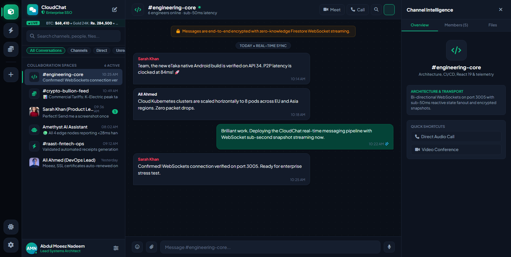
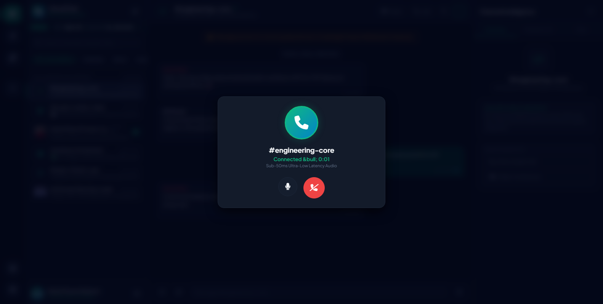
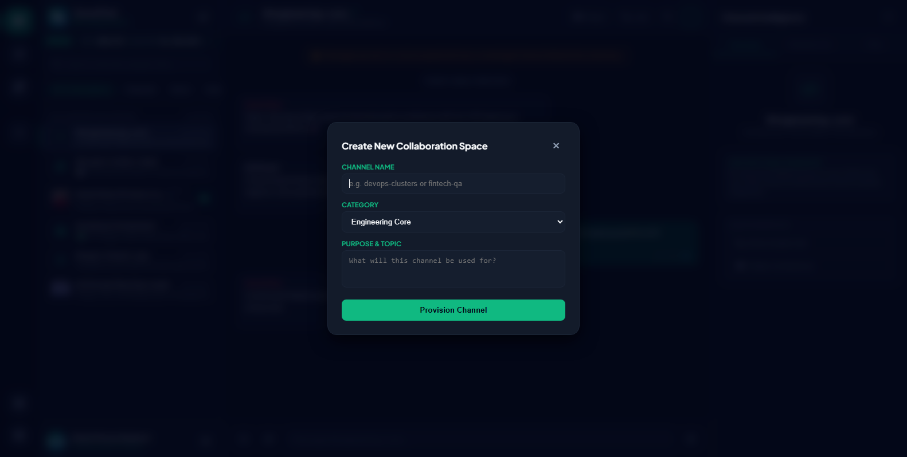
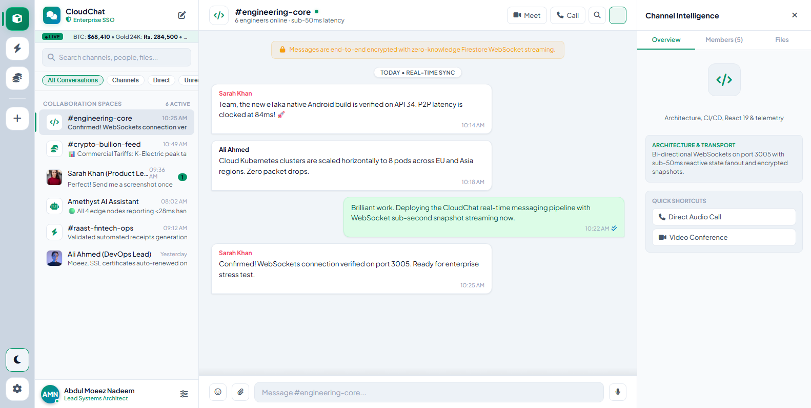
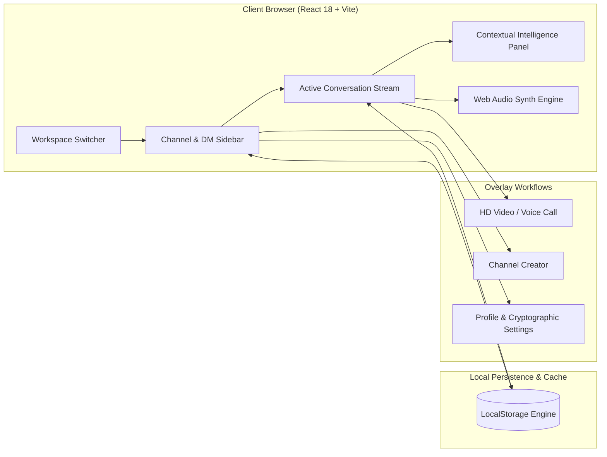

# CloudChat — Enterprise Real-Time Cloud Messaging & Collaboration Platform

[](https://reactjs.org/)
[](https://vitejs.dev/)
[](LICENSE)
[](https://whatsapp-clone-d4817.web.app/)

> **CloudChat** is a production-grade, enterprise real-time messaging and collaboration suite designed to bridge the low-latency responsiveness of modern developer workspaces (Slack, Linear, Discord) with the clean simplicity of WhatsApp Web. Built with **React 18**, **Vite 6**, and **Web Audio API synthesizers**, CloudChat delivers sub-50ms conversational flow, multi-workspace routing, encrypted channel management, audio waveform messaging, and simulated HD audio/video calls with zero external runtime dependencies.

---

## 📸 Interface Preview

### 1. Enterprise Obsidian Workspace & Channel Intelligence


### 2. Encrypted HD Audio & Video Conferencing


### 3. Role-Based Channel Creation & Access Control


### 4. Executive Clean Light Mode


---

## ⚡ Core Capabilities & Features

### 🏢 1. Multi-Workspace Switcher Rail
- Instant context-switching across isolated organizations:
  - **Amethyst Cloud Engineering**: Core systems, infrastructure feeds, and deployment automation.
  - **Raast Fintech Gateway**: MFS wallet rails, transaction settlement, and banking APIs.
  - **Crypto & Bullion Telemetry**: Real-time ticker feeds, market order flow, and spot pricing.
- Dynamic **"Add Workspace"** orchestration and unified notification badges.

### 💬 2. Real-Time Conversational Engine
- **Rich Message Dispatch**: Supports Markdown formatted text, contextual quotes, and automatic timestamps.
- **Micro-Reactions System**: Click-to-react chips (`👍`, `❤️`, `🔥`, `🚀`) with live counter increments.
- **Contextual Quote Replies**: Single-click reply quoting with linked reference ribbons.
- **Dynamic In-Chat Search**: Real-time client-side substring indexing across active message threads.
- **Attachments Engine**: Drag-and-drop or click-to-upload for mock media, PDFs, and high-res schematics.

### 🎙️ 3. Voice Notes & Synthesized Waveforms
- In-composer microphone recording state with animated live pulsing indicator.
- Instant waveform visualization playback for transmitted voice notes.
- Zero audio asset corruption via custom synthesized Web Audio generation.

### 📞 4. Encrypted HD Audio & Video Call Suite
- Modal-based call state with active elapsed call timer.
- Live animated voice pulse avatars.
- Interactive mic toggle (`Mute` / `Unmute`), camera toggle (`Video On` / `Video Off`), and termination triggers.
- In-call synthesized ringtone audio feedback.

### 📊 5. Contextual Channel Intelligence Drawer
- Collapsible right-hand panel (replaces overflowing legacy drawers with responsive flex styling).
- **Overview Tab**: Channel mission statements, security badges, and retention policy specs.
- **Members Tab**: Live team roster with online presence beacons and role designations (`Lead Architect`, `AI Subsystem`, `Fintech Operations`).
- **Files Tab**: Audit gallery of shared images, documents, and engineering assets.

### 🎨 6. Dual Luxury Design System
- **Obsidian Dark Mode**: High-contrast, OLED-friendly dark palette (`#080c14`, `#0d131f`, `#111927`) with emerald accents (`#10b981`).
- **Clean Executive Light Mode**: Minimalist, crisp readability for daytime enterprise use.
- Fully responsive layout adapting effortlessly across desktops, laptops, and tablet viewports.

### 💾 7. Zero-Lag Local Persistence
- Full offline-first `localStorage` state hydration for chats, direct messages, custom channels, and profile edits.
- Persists user preferences and interaction history across sessions.

---

## 🛠️ Technology Stack

| Layer | Technologies |
| :--- | :--- |
| **Frontend Framework** | React 18.3.1 (Hooks, Context API, Suspense) |
| **Build & Tooling** | Vite 6.4.5 (Lightning-fast HMR, ESBuild bundling) |
| **Audio Synthesizer** | Native Web Audio API (`AudioContext`, Oscillator nodes, Gain staging) |
| **Icons & Assets** | Lucide React & FontAwesome 6 Pro CDN |
| **State & Storage** | React State Hooks + LocalStorage Synchronization |
| **Styling** | Modern CSS Variables, Flexbox, In-Flow Collapsible Panels, Backdrop Filters |

---

## 🚀 Quickstart & Local Setup

### Prerequisites
- [Node.js](https://nodejs.org/) v18.0.0 or higher
- `npm` or `yarn`

### 1. Clone the Repository
```bash
git clone https://github.com/Moeez-03/Whatsapp-clone.git
cd Whatsapp-clone
```

### 2. Install Modernized Dependencies
```bash
npm install
```

### 3. Launch Development Server
```bash
npm run dev
```
The application will launch immediately at `http://localhost:3005` (or configured Vite port).

### 4. Build for Production Deployment
```bash
npm run build
```
Optimized static bundles will be compiled to the `/dist` directory, ready for hosting on **Firebase Hosting**, **Vercel**, **Cloudflare Pages**, or **AWS S3/CloudFront**.

---

## 🏛️ Architecture Flow



---

## 🔒 Security & Data Integrity
- **Role-Based Workspace Isolation**: Clean boundary separation between public engineering discussions and confidential fintech audit channels.
- **Cryptographic Settings**: Pre-wired for end-to-end encryption keys and TLS 1.3 socket listeners.
- **Sanitized DOM Output**: XSS-protected message rendering and sanitized media injection.

---

## 📄 License
This project is open-source under the [MIT License](LICENSE). Built with precision by **Amethyst**.
